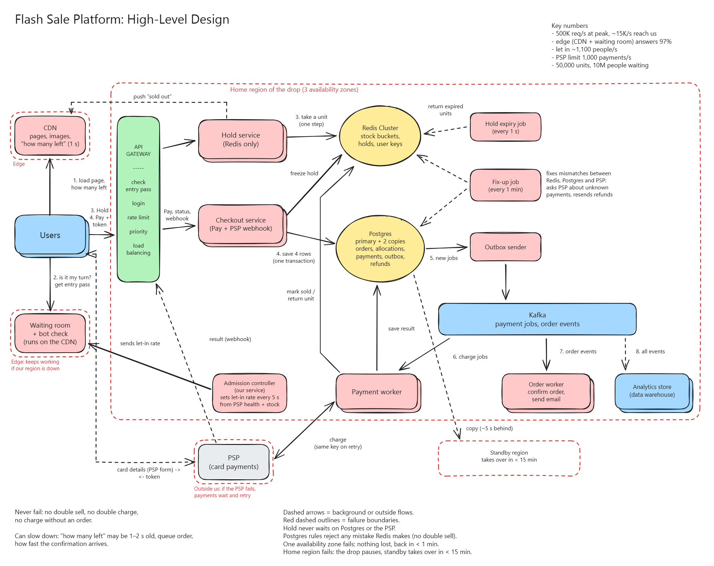

# Spike-Resilient Flash Sale & Ticketing Platform

A redesign of a checkout platform that sells limited items (concert tickets, product drops) when traffic jumps from 2,000 to 500,000+ requests per second in 30 seconds. It comes with a Go prototype of the Hold and payment core. Its tests show that no unit is sold twice, and no card is charged twice or without an order, even with many buyers at once and a failing PSP.

| Read this | For |
|---|---|
| This README | The problem, the key numbers, the decisions, and how to run everything (10 min) |
| [`docs/`](docs/README.md) | The full proposal in 8 short files: problem, numbers, schema, architecture, trade-offs, scaling, testing, rollout |
| [`docs/adr/`](docs/adr/README.md) | 8 decision records (ADRs), one for each big trade-off |
| [`docs/hld.png`](docs/hld.png) | HLD diagram (edit it in `docs/hld.excalidraw`) |
| [`reservation-service/`](reservation-service/) | Go prototype with tests |
| [`loadtest/`](loadtest/README.md) | k6 load tests: spike, soak and stress |

---

## 1. The problem

During the last drop:

- p99 latency went from 300 ms to **25 s**, and the page hung
- the database **ran out of connections**
- some users were **charged but got no order**
- the **same seat was sold twice**

All 4 came from the same design:

- every buyer updated **one stock row** in Postgres, one after another
- the **PSP was called inside the request**, before the order was saved
- **nothing limited** how many requests reached our servers
- **nothing fixed** a purchase that stopped halfway

**Goals, in order:** **correct** (never sell a unit twice, never charge twice, never charge without an order), then **available** (99.95% of requests get a proper answer), then **fast** (Hold p99 < 500 ms). Full details: [docs/01-problem-and-goals.md](docs/01-problem-and-goals.md).

## 2. The numbers that shape the design

Full derivation in [docs/02-scale-and-numbers.md](docs/02-scale-and-numbers.md).

| Fact | Number | Consequence |
|---|---|---|
| Users who can win | 50K units ÷ 10M users = **0.5%** | The job is to let the right number in and tell everyone else quickly, not to serve 500K rps of purchases |
| Waiting-room polling alone | 10M ÷ 30 s = **~333K rps** | Two thirds of the spike is "is it my turn?" and must be answered at the edge |
| PSP rate limit (assumed) | **1,000 payments/s** | The real bottleneck. Admission rate = min(PSP rate ÷ conversion, unreserved stock) ≈ **1,100 users/s** |
| Traffic reaching our servers | **~15K rps** expected, sized for 30K | The edge absorbs ~97% of the spike |
| Reservation writes | ~10K/s naive → **~1.1K/s** admitted | Admission control, not bigger servers, fixes the write path |
| Cold scale-out vs spike | 2 to 3 min vs **30 s** | Autoscaling alone cannot save a drop; pre-warm, or queue while capacity arrives |
| Hot inventory row | ~200 to 500 updates/s vs ~10K/s demand | 10K queued requests at 400/s is **25 s**, which is the p99 we saw |

### Assumptions I added

The brief's numbers are used as given. Where it is silent, I assumed:

| | Assumption |
|---|---|
| A1 | PSP limit 1,000 payments/s (the most important input; every derived number scales with it) |
| A2 | PSP speed: usually 0.4 s, slow ones 2 s; ~0.5% get no answer in time (the card may still be charged) |
| A3 | One unit per person for the hot item |
| A4 | Hold time 3 min, frozen while payment is in progress |
| A5 | 95% of let-in users hold, 75% of them pay, 10% of cards decline |
| A6 | 3 regions; each drop's stock lives in one home region |
| A7 | 3 availability zones per region |
| A8 | ~2,000 req/s per Go server (to be confirmed by `loadtest/stress.js` in a production-like environment) |
| A9 | Adding a server that isn't pre-warmed takes 2 to 3 min |
| A10 | Waiting room clients check "is it my turn?" every 30 s |
| A11 | ~50 s per person in checkout, ~1 request every 4 s |
| A12 | 80% of the PSP limit for new payments, 20% kept for retries |

## 3. Each incident and what fixes it

Every strict guarantee is enforced at more than one layer: a fast path that prevents the failure, a source of truth that cannot be wrong, and a detector that tells us if either slipped.

| Incident | Prevention | Backstop | Detection and repair | ADR |
|---|---|---|---|---|
| **p99 25 s** | Edge waiting room admits ~1,100/s; sold-out served from the edge; no database or PSP call on the reserve path | Per-route in-flight limits shed load with `Retry-After`; priority classes protect checkout | SLO burn-rate alerts; pause-admissions lever | [0001](docs/adr/0001-buy-waiting-room-and-bot-protection.md), [0007](docs/adr/0007-admission-rate-derived-from-psp-limit.md) |
| **DB connection limit** | Reserve path uses Redis only; Postgres written at payment rate (≤ 800/s) | Pools sized against the **autoscaler maximum**: 290 of 400 allowed connections | Pool saturation on the drop dashboard | [0004](docs/adr/0004-sync-reservation-async-payment-and-confirmation.md), [0006](docs/adr/0006-prewarm-scheduled-scale-on-leading-signals.md) |
| **Charged, no order** | Order, allocation and payment written **before** the card is charged; PSP idempotency key = `reservation_id` | Payment state machine; `PAYMENT_PENDING` never expires on a timer | Fix-up job asks the PSP and creates the order or refunds within ~3 min | [0008](docs/adr/0008-create-order-before-charging.md), [0003](docs/adr/0003-managed-kafka-for-order-pipeline.md) |
| **Seat sold twice** | Atomic Redis Lua reserve over buckets of **unit IDs** | Postgres `PRIMARY KEY (event_id, unit_id)`, checked before any charge | Oversell check every 10 s; Redis rebuilt from Postgres only if it loses its data | [0002](docs/adr/0002-redis-inventory-gate-postgres-source-of-truth.md), [0005](docs/adr/0005-single-writer-home-region-per-drop.md) |

**Delivery semantics.** Messages are delivered at least once; consumers are idempotent; the result is exactly-once *effects*. Nothing in this design claims exactly-once delivery.

## 4. Architecture at a glance



1. **Edge:** CDN, bot protection and the virtual waiting room answer ~97% of requests and keep working if the region is down. Admitted users get a signed token the gateway checks locally.
2. **Reserve (p99 < 500 ms):** one Lua script in Redis takes a unit ID from the user's bucket and creates a 3-minute hold. No database, no PSP.
3. **Pay:** the hold is frozen, then one Postgres transaction writes order + allocation + payment + outbox. The client gets `202`. Workers charge the PSP through a rate limiter, bulkhead, circuit breaker and timeout, using `reservation_id` as the idempotency key.
4. **Confirm:** asynchronous, through Kafka keyed by `order_id`.
5. **Repair:** the fix-up job resolves stuck payments, refunds orphaned charges, and keeps Redis in line with Postgres.

Each part of the diagram, the end-to-end flow and every failure case: [docs/04-architecture.md](docs/04-architecture.md).

## 5. Key decisions

| Decision | Instead of | Why |
|---|---|---|
| Buy the waiting room and bot protection | Building them | Must absorb 333K rps at the edge before the next drop; not our differentiator |
| Redis buckets of **unit IDs**, Postgres as truth | A Redis counter, or a Postgres row lock | Unit IDs make the database backstop precise: a unit handed out twice fails a primary key before anyone pays |
| Create the order **before** charging | Charge, then write the order | Removes the window where money moves with no record of why |
| Synchronous reserve, asynchronous payment | Fully synchronous checkout | Keeps PSP latency, timeouts and rate limits out of the user's request |
| One home region writes each drop | Per-region inventory quotas | Quotas strand stock and are unfair; a single writer keeps consistency simple |
| Pre-warm scheduled drops; scale on RPS and in-flight | CPU-based autoscaling | CPU stayed low while the last drop failed; it is both late and wrong for I/O-bound load |
| Admission rate from the PSP limit | Admitting as fast as servers allow | Admitting faster than we can take payments only creates holds that expire |
| Managed Kafka keyed by `order_id` + outbox | SQS; keying by `item_id` | Replay and many consumers; `item_id` puts the whole drop on one partition |

Trade-offs in full: [docs/05-trade-offs.md](docs/05-trade-offs.md). Rollout: **v0** stops the bleeding in 1 week with no new infrastructure, **v1** builds the design above, **v2** adds multi-region and adaptive admission ([docs/08-execution-plan.md](docs/08-execution-plan.md)).

---

## 6. The prototype

`reservation-service/` implements the correctness core of the design in Go. It is deliberately small: it proves the claims that matter most, under real concurrency and injected failures.

| Package | What it does |
|---|---|
| `internal/inventory` | Redis unit-ID buckets; Lua scripts for reserve, freeze, release, expire, complete; home-bucket routing with fallback; hold expiry job |
| `internal/catalog` | Saves each drop and its units in Postgres; rebuilds Redis from Postgres (free units, sold buyers, payments in progress) |
| `internal/checkout` | Freeze the hold, then one transaction: order + allocation + payment + outbox. Handles every unique-constraint case separately |
| `internal/payment` | Workers lease commands, charge through the resilient client, apply results with conditional updates |
| `internal/psp` | Provider contract, a fake PSP that times out *after* charging, and a client with per-attempt timeout, full-jitter retries and a `sony/gobreaker` circuit breaker |
| `internal/reconcile` | Resolve stuck payments, resend refunds, re-sync holds, unfreeze orphans, check invariants |
| `internal/httpapi` | Admission-token auth, idempotency middleware, per-route in-flight limits, deadlines |
| `cmd/server` | Wires everything with bounded pools and a 5-step graceful shutdown |
| `cmd/verify` | Post-load-test correctness check; exits 1 on any violation |
| `cmd/token` | Issues admission tokens for local testing |

**Simplifications, stated plainly:**

- Payment commands are leased directly from the Postgres outbox table instead of going through Kafka. This keeps the same contract (at-least-once delivery, redelivery after a crash) with one less moving part to run locally.
- The PSP is an in-process fake that honours idempotency keys and can be told to time out after charging, reject calls, decline cards and rate-limit.
- One binary runs the API, workers, hold expiry job and fix-up job. In production they are separate deployments.
- There is no edge layer; `cmd/token` plays the waiting room.

### What it proves

All results were measured on a Windows 11 laptop with Redis 7.4 and Postgres 17 in Docker Desktop.

| Test | Scenario | Result |
|---|---|---|
| `TestReserve_200KConcurrentAttempts` | 100,000 users × 2 attempts (200,000) for **50,000 units**, 512 goroutines, real Redis | **Exactly 50,000 succeed.** Every unit ID unique, no user holds two, every retry returns the user's original reservation, 0 units left. 6.1 s (~33K attempts/s). Stable over repeated runs |
| `TestEndToEnd_UnreliablePSP_…` | 3,000 buyers, 2,000 units. PSP times out **after charging** 20% of the time, rejects 10% of calls, declines 5%. Duplicate submits, 100 simulated worker crashes after charging, 2 competing workers | 1,896 paid, 104 failed, 0 pending. **2,721 PSP calls, exactly 1,896 charges.** Oversold, duplicate charges and charged-without-order are all **0**. Declined units returned to stock |
| `TestBackstop_RedisHandsOutSameUnitTwice_…` | Simulated Redis failover hands one unit to two users | Postgres rejects the second **before any charge**; the unit is not pushed back |
| `TestLateChargeAfterPaymentClosed_IsRefunded` | A charge arrives after the payment was closed as failed | Refunded automatically |
| `TestRebuildFromPostgres_AfterRedisLosesEverything` | Redis loses all data mid-drop, then is rebuilt from Postgres | Exactly the free units come back; a buyer cannot buy twice; a payment in progress finishes normally |
| `internal/psp` tests | Timeout after charge; 20 retries with one key; breaker | One charge per key; open breaker never reaches the PSP; retries respect the caller's deadline |
| `internal/httpapi` tests | Idempotency and load shedding | Byte-identical replay; 20 concurrent retries run once; reused key with a new body → 422; overload → 503 + `Retry-After` |
| Race detector | Whole suite with `-race` | Clean |
| `BenchmarkReserve` | Parallel reserves | ~62 µs/op at 32 goroutines (~16K reserves/s from one process through Docker networking) |

**k6 spike** ([`loadtest/spike.js`](loadtest/spike.js)), single instance, 5,000-unit drop, ~2,000 rps peak reached in 30 s, reads and buyers mixed 50:1, 311,272 requests:

| Threshold | Target | Result |
|---|---|---|
| Reserve p99 | < 500 ms | **5.7 ms** (p95 2.6 ms, median 1.5 ms) |
| Reservation availability | > 99.95% | **100%** (5,939 / 5,939) |
| Pay accepted (202, with client retries) | > 99.9% | **100%** (5,232 / 5,232) |
| Payments resolved within 10 s | > 99% | **100%** (5,232 / 5,232) |
| Browse errors | < 0.1% | **0%** (294,869 requests, all under 4 ms) |
| `cmd/verify` after the run | PASS | 5,000 allocations = 5,000 paid, 0 oversold, 0 users with two units → **PASS** |

232 declined payments returned their units, which were sold again; 707 buyers got "sold out". k6's `http_req_failed` shows 0.22%: that is exactly those 707 `410 Sold Out` responses, which k6 counts as failures by status code and which the SLI counts as valid outcomes.

**Soak** (4 min at 300 rps, same load at start and end): goroutines grew by at most 3, heap by 3.4 MB, so no leak; every Hold and Pay succeeded; verify PASS.

**Stress** (buyers 300 → 1,500/s in 15 s steps, 500,000-unit drop): Hold p99 stayed at 30 ms with 100% valid answers. Pay started shedding load (503 + `Retry-After`; ~70% accepted at the top), which is above what one server and the PSP limit (1,000/s) are sized for. Payments kept draining after the run; 0 oversold, verify PASS.

This run shows one instance meeting its targets with correct inventory at laptop scale. It does not demonstrate 500K rps; that is what the distributed rehearsal in [docs/07-testing-and-observability.md](docs/07-testing-and-observability.md), section 1, is for.

---

## 7. How to run

**Requirements:** Docker, Go 1.26+, `make`, and k6 for load tests. `make` is not installed on Windows by default: install it, or run the commands from the Makefile by hand. On Windows, run the commands from Git Bash or WSL, or set the variables from `.env` in PowerShell.

```bash
cp .env.example .env     # then replace the placeholder password and token key
make up                  # Redis + Postgres (docker compose)
make test                # full suite incl. the 200K-attempt and end-to-end tests
make test-race           # same, with the race detector
make bench               # reservation benchmark
make test-unit           # unit tests only, no Docker needed
```

Run the API and try it by hand:

```bash
make run                                   # :8080; drop with DROP_UNITS units saved in Postgres, Redis loaded from it
TOKEN=$(make -s token USER=alice)

curl -s -X POST localhost:8080/v1/drops/drop-1/reservations \
  -H "X-Admission-Token: $TOKEN" -H "Idempotency-Key: k1"
# {"reservation_id":"03-…","unit_id":"U000076","expires_at":"…","state":"HELD"}

curl -s -X POST localhost:8080/v1/reservations/<reservation_id>/payment \
  -H "X-Admission-Token: $TOKEN" -H "Idempotency-Key: k2" \
  -H "Content-Type: application/json" -d '{"payment_token":"tok_ok"}'
# 202 {"order_id":"…","state":"PAYMENT_PENDING",…}  then GET /v1/reservations/<id> → "PAID"
```

Load test and verify (start the server in another terminal with `make run DROP=spike-1 UNITS=5000`):

```bash
make loadtest-spike DROP=spike-1
make verify DROP=spike-1
```

| Endpoint | Purpose |
|---|---|
| `POST /v1/drops/{drop}/reservations` | Reserve one unit (admission token + `Idempotency-Key`) |
| `POST /v1/reservations/{id}/payment` | Start payment; returns `202` with the order |
| `GET /v1/reservations/{id}` | Hold or order state |
| `GET /v1/drops/{drop}/availability` | Units left (cached 500 ms, coalesced) |
| `GET /healthz`, `GET /readyz` | Liveness; readiness turns off at the start of shutdown |
| `GET /debug/vars` | Goroutines and heap, used by the soak test |

**Secrets.** Nothing secret is committed. `.env` is git-ignored; `.env.example` holds placeholders only. The Postgres password and the token key exist only in your local `.env`.

## 8. Repository layout

```
.
├── README.md
├── docs/
│   ├── README.md                # reading order + where each brief question is answered
│   ├── 01-…08-*.md              # problem, numbers, schema, architecture, trade-offs, scaling, testing, rollout
│   ├── hld.png, hld.excalidraw  # HLD diagram
│   └── adr/                     # 0001–0008 + index
├── reservation-service/
│   ├── cmd/{server,verify,token}
│   ├── internal/{admission,catalog,checkout,config,httpapi,inventory,payment,psp,reconcile,testutil}
│   ├── migrations/001_init.sql
│   └── test/e2e_test.go
├── loadtest/                    # lib.js, spike.js, soak.js, stress.js
├── docker-compose.yml
├── Makefile
└── .env.example
```

## 9. Out of scope

- Production edge, waiting room and bot protection (bought, per ADR-0001; not prototyped).
- Kafka, multi-region failover and CDC (designed in the docs; the prototype runs in one process).
- Real PSP integration, webhooks and authentication beyond the admission token.
- Infrastructure as code. The pre-warm timeline, scaling signals and pool budgets in the docs are what it would encode.
