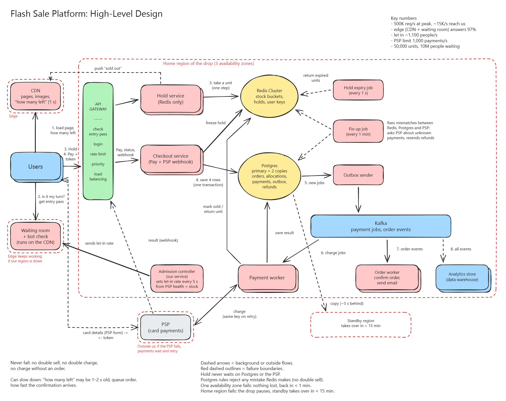

# Architecture

*(editable version: `hld.excalidraw`)*

## 1. Main ideas

1. **Stop load at the edge.** The CDN and the waiting room answer 97% of requests. Only people we let in reach our servers.
2. **Hold (reservation) never touches the database.** It uses Redis only, so it stays fast at any load.
3. **The database is written at payment speed** (≤ 800/s), not at click speed.
4. **Save the order before charging the card.** A charge can never happen without an order.
5. **Every step is safe to repeat:** idempotency keys, unique rules in Postgres, workers that skip duplicates.
6. **Two layers for the strict rules:** Redis decides fast, Postgres rules reject any mistake.

## 2. Each part

| Part | What it does | Key choices |
|---|---|---|
| **CDN** | serves pages, images and "how many left" | "how many left" is cached 1 s, so the CDN asks us only about once a second per item; the sold-out page is pushed here |
| **Waiting room + bot check** (on the CDN) | holds up to 10M people, lets them in at the rate we set | each person let in gets an **entry pass** (signed, says who and which drop, valid 10 min); bot check when joining the queue; we buy this, not build it |
| **Admission controller** (our service) | sets the waiting room's let-in rate every 5 s | reads PSP health and free stock; normal ~1,100/s, lower when the PSP is slow, 0 when no stock is free; also the on-call "pause admissions" switch |
| **API Gateway** | front door for all our APIs | checks the entry pass itself (no extra network call), login, per-user rate limit, priority (Pay before Hold before browse); when full, it answers "try again in X s" instead of slowing down |
| **Hold service** | gives a person a unit for 3 min | one Redis script: check the person has no hold, take a unit, save the hold, start the timer. No Postgres, no PSP. Pushes "sold out" to the CDN when everything is gone |
| **Checkout service** | Pay, status checks, PSP webhook | **Pay:** freezes the hold (so it can't expire), saves 4 rows in one transaction, answers `202`. **Status:** reads the order from Postgres. **Webhook:** checks the PSP's signature, saves the result only if the payment is still pending |
| **Redis Cluster** | stock and holds | 6 shards, each with a copy in another availability zone; 50 buckets spread over them; can be rebuilt from Postgres |
| **Postgres** | the truth for money and ownership | primary + 2 copies; every save waits for one copy in another availability zone, so nothing is lost if the primary dies; PgBouncer in front |
| **Outbox sender** | moves jobs from the `outbox` table to Kafka | needed because we can't save to Postgres and send to Kafka in one step (see `05-trade-offs.md`) |
| **Kafka** | carries jobs between services | 2 main topics (payment jobs, order events) + 3 retry topics + 1 dead-letter topic for payment jobs; split by order ID into 48 parts; every message kept on 3 machines |
| **Payment worker** | charges the card, saves the result | the reservation ID is the PSP's idempotency key, and each charge carries the order, user, drop and unit IDs as metadata (used to rebuild orders after a region failure), so a retry never charges twice; max 800/s; 2.5 s timeout; retries with growing waits; stops calling the PSP when it's failing (circuit breaker). After the result: marks the unit sold or puts it back in Redis |
| **Order worker** | after payment: marks the order confirmed in Postgres, sends the email | skips messages it already handled (`processed_messages`) |
| **Hold expiry job, Fix-up job** | background clean-up | see `03-entities-apis-schema.md`, section 6 |
| **PSP** | the outside card company | card details go from the user straight to the PSP's form; we only get a token. Only the payment worker charges, and the PSP can also send results by webhook |

### Where data lives

| Store | What's in it | Why here |
|---|---|---|
| **Redis** (in memory) | stock lists, holds, each person's "has a hold" key, saved answers for idempotency keys | fast enough for every click; all of it can be rebuilt from Postgres |
| **Postgres** (relational database) | orders, allocations, payments, refunds, outbox jobs, `processed_messages` | money and ownership: saving several rows in one transaction, plus unique rules that block a double sale |
| **NoSQL** (for example DynamoDB) | not used | our data needs transactions and unique rules, which Postgres does simply (05-trade-offs.md, row 16). The waiting room vendor keeps the queue on its side |
| **Kafka** (event log) | payment jobs and order events, kept 7 days | jobs wait safely between steps; many readers; past events can be processed again after a bug |
| **Analytics store** (a data warehouse, for example BigQuery or Snowflake) | a copy of order and payment events, read from Kafka | reports and dashboards after the drop. It is never on the buying path, so being minutes behind is fine, and heavy reports never slow Postgres |
| **CDN** | pages, images, the sold-out page | served close to users, even when our servers are down |

### Caching

| Layer | What it caches | How long | How it's updated |
|---|---|---|---|
| **CDN** | pages and images | hours | each deploy uses new file names, so old copies are never served |
| **CDN** | drop details (name, price, start time) | minutes | cleared from the CDN when a drop is edited (rare) |
| **CDN** | "how many left" | 1 s | runs out by itself; the CDN asks us about once a second per item |
| **CDN** | the sold-out page | until the drop ends | the Hold service pushes it to the CDN the moment the last unit is held |
| **Each server** (in its own memory) | "how many left" | 500 ms | runs out by itself. Requests that arrive at the same moment share one Redis read, so Redis sees about 2 reads a second per server, not one per request |
| **Redis** | saved answers for idempotency keys | 30 s while running, then 24 h | written once; a repeat gets the saved answer |

**Never cached:** the Hold decision and the payment status. They always come from Redis and Postgres, because they must be exact.

So "how many left" is at most ~1.5 s old (1 s on the CDN + 500 ms on the server). That matches the "may be 1–2 s old" in doc 01, section 4.

## 3. End-to-end flows

### 3.1 Happy path

| # | Step | What happens |
|---|---|---|
| 1 | Open the drop page | the CDN serves the page and "how many left" |
| 2 | Join the queue | the waiting room checks for bots and keeps the person's place; when it's their turn, they get an **entry pass** |
| 3 | Click **Hold** | Gateway checks the pass → Hold service → one Redis script takes a unit → `201`, with a 3 min timer |
| 4 | Enter card details | they go straight to the PSP's form; the browser gets a **token** back |
| 5 | Click **Pay** (token + idempotency key) | Checkout service freezes the hold in Redis, then saves 4 rows in one transaction: order (PAYMENT_PENDING), allocation, payment (PENDING), outbox job "charge" → `202` |
| 6 | Job goes to Kafka | the outbox sender sends the "charge" job to Kafka |
| 7 | Charge | the payment worker calls the PSP (key = reservation ID) → success → one transaction: payment SUCCEEDED, order PAID, outbox job "paid" → Redis: unit marked sold |
| 8 | Confirm | the outbox sender sends "paid" to Kafka → the order worker marks the order confirmed and sends the email |
| 9 | User sees "Paid" | the browser checks the status every 1–2 s; it usually takes 1–3 s from clicking Pay |

**Order states:** PAYMENT_PENDING → PAID, or FAILED. A late charge after FAILED → REFUNDED.

### 3.2 When something goes wrong

| What goes wrong | What we do | End result |
|---|---|---|
| **Card declined** | payment DECLINED, order FAILED, allocation deleted, unit put back in Redis | the user can try again if stock is left |
| **PSP gives no answer** (timeout) | never mark failed, never release the unit; 5 quick tries with the **same key**, then retry topics (5 s, 30 s, 2 min), then the fix-up job asks the PSP directly | charged → PAID; not charged → FAILED and the unit goes back. Never charged twice |
| **Charge arrives after we marked FAILED** | save a refund row, send the refund to the PSP (with its own idempotency key) | the money goes back |
| **Hold not paid in 3 min** | the hold expiry job returns the unit and clears the user's key | the unit is offered to the next person |
| **Double click / retry** on Hold or Pay | the idempotency key returns the first answer; Postgres unique rules stop a second order | one hold, one order, one charge |
| **Payment worker crashes mid-charge** | another worker picks the job up again (from Kafka's bookmark), with the same key | the PSP sees the same key → no second charge |
| **Checkout crashes after freezing the hold, before saving** | the fix-up job finds the frozen hold with no order after 2 min and unfreezes it | the unit isn't stuck |
| **Paid, but marking the unit sold in Redis fails** | the order is PAID in Postgres; the fix-up job sees "PAID in Postgres, still frozen in Redis" and marks it sold | Redis catches up; the unit is never offered again |
| **PSP webhook is lost** | the worker's own call already gave the result; if not, the fix-up job asks the PSP after 2 min | the payment is still settled |
| **Redis primary fails** | its copy takes over in seconds. If a hold was lost and the unit went to a second person, Postgres rejects the second allocation | that second person isn't charged; no double sell |
| **Redis loses all data** | pause Holds, rebuild from Postgres (`03-entities-apis-schema.md`, section 5), resume | only unpaid holds are lost |
| **Postgres primary fails** | the copy in another availability zone takes over in < 1 min; nothing is lost; Pay answers "try again" meanwhile | Hold keeps working (Redis only) |
| **PSP slow or down** | the circuit breaker stops calls; jobs wait in the queue; the admission controller lowers the let-in rate | no extra load on the PSP; paying users' units stay frozen, so they don't expire |
| **Kafka slow or down** | outbox rows wait in Postgres and are sent later | nothing lost, only delayed |
| **Hold expiry job stops** | alert within 10 s; another copy takes over | expired units come back late, but nothing is oversold |

### 3.3 Extension: cards that need an OTP (for example, India)

The flow above is our core flow: the card is charged with no extra step. In some countries, the bank must check a one-time code (OTP) before most online card payments (3-D Secure). In India this is required by the central bank for cards issued there. The EU has a similar rule (strong customer authentication).

For drops sold in those countries, we add the OTP as an **extension** to the core flow. It's one extra browser step; the rest of the flow stays the same, as shown below.

**What changes:** one extra step in the browser, between entering the card and clicking Pay. The PSP's own page asks the bank whether an OTP is needed. If it is, the bank's page opens, the user types the code, and the PSP marks the card token as verified. Then Pay works exactly as in section 3.1, and the worker charges in the background with no OTP asked.

**What stays the same:** retries with the same key, PSP timeouts, worker crashes, declines, double clicks and late charges (section 3.2). The OTP was already done for this payment, so a retry with the same reservation ID gets the first result back: no second OTP, no second charge.

| New case | What we do | End result |
|---|---|---|
| **OTP wrong, expired, or the user closes the bank page** | nothing is saved yet, so there's nothing to clean up | no money taken; the user can try again, or the hold expires and the unit goes back |
| **The OTP approval runs out before we charge** (for example, jobs waited in Kafka during a PSP outage) | the user does the OTP again for the **same payment**; the hold stays frozen meanwhile (steps below) | the user keeps their unit. There's still one payment and one key, so no double charge. No OTP within 5 min → FAILED, unit goes back |
| **The user tries again after a decline** | it's a new payment attempt, so the bank asks for a new OTP | same as any online shop |

**When the OTP approval runs out, end to end:**

The PSP doesn't fail the payment; it pauses it ("needs action"). The same payment, with the same key, continues after the OTP. Nothing is closed and no new key is used, except in step 8.

| # | Step | What happens |
|---|---|---|
| 1 | Pay | the user did the OTP and clicked Pay → hold frozen, 4 rows saved, order PAYMENT_PENDING, `202` |
| 2 | PSP down | the charge job waits in Kafka (for example 10 min), and the bank's OTP approval runs out |
| 3 | Charge | the PSP is back. The payment worker charges with the same key (`reservation_id`). The PSP pauses the payment, answers "needs OTP", and sends a link for this payment. No money is taken |
| 4 | Save | the worker sets the payment to NEEDS_ACTION (with the link) and the order to NEEDS_VERIFICATION, with a deadline of now + 5 min. The hold stays frozen, so no one else can take the unit |
| 5 | Tell the user | the status check shows "please verify your card again" and opens the PSP's link. We also send the link by email, because the user may have left the page during the outage |
| 6 | OTP | the user types the code on the PSP's page, and the PSP continues **the same payment** |
| 7 | Result | the PSP webhook arrives → the checkout service saves it only if the payment is still NEEDS_ACTION → payment SUCCEEDED, order PAID, outbox job "paid" → unit marked sold in Redis → confirmation email (section 3.1, steps 7–9) |
| 8 | No OTP in 5 min | the fix-up job (every 1 min) cancels the payment at the PSP and waits for "cancelled" → payment CANCELLED, order FAILED, unit back in Redis. If the PSP says it was paid just before the cancel, the order is set to PAID instead |
| 9 | Late charge | a charge that still arrives after FAILED is refunded (section 3.2) |

**Payment states in this case:** PENDING → NEEDS_ACTION → SUCCEEDED, or CANCELLED if there's no OTP in 5 min. It's the same payment row the whole time.

**If a PSP can't pause and continue a payment:** we cancel it first, wait for "cancelled", and only then start a new attempt with a new key (`reservation_id-2`). This needs an attempt number on payments, because today `UNIQUE (reservation_id)` allows only one payment per reservation.

**Numbers to update:** some people fail or give up on the OTP, so fewer reach payment than the 71% we use now, and the let-in rate is lower. Each person also stays ~1 min longer in checkout, so more people are inside at once. We're built for 2×, so it still fits. The 3 min hold must cover the OTP too; raise it to 5 min if needed.
